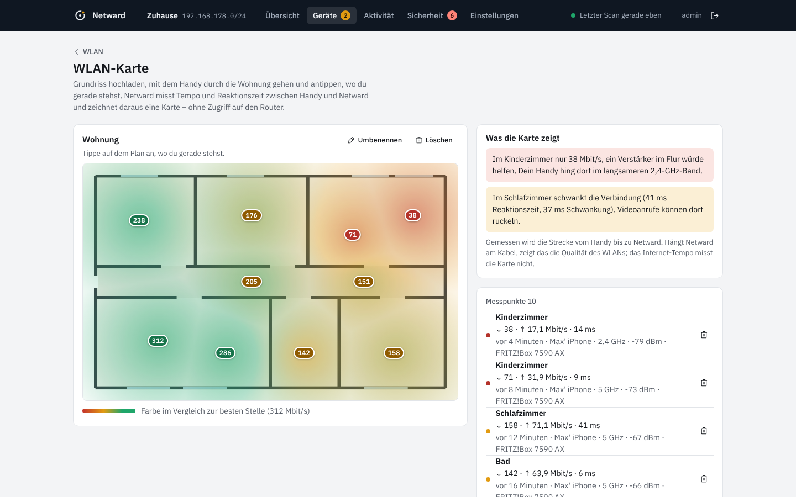
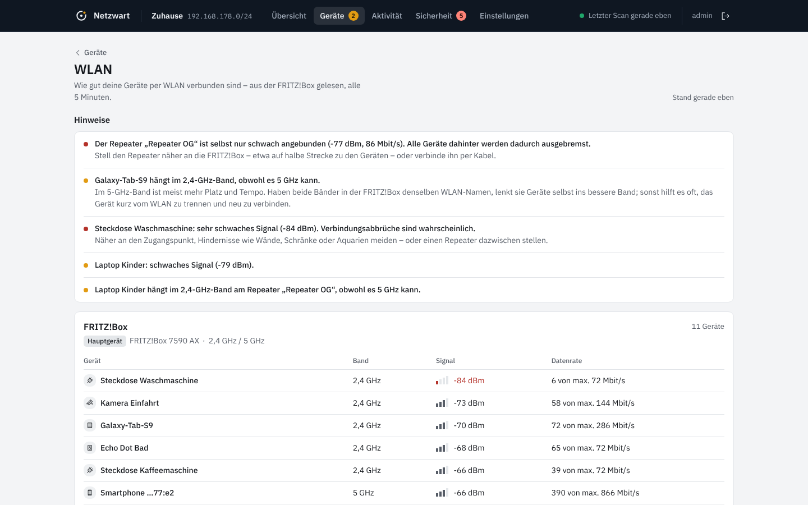
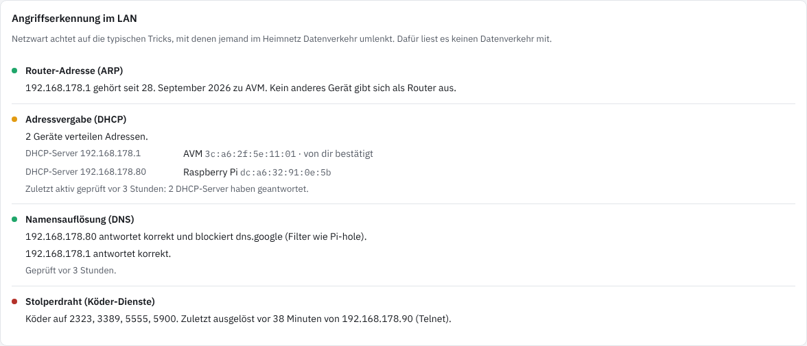
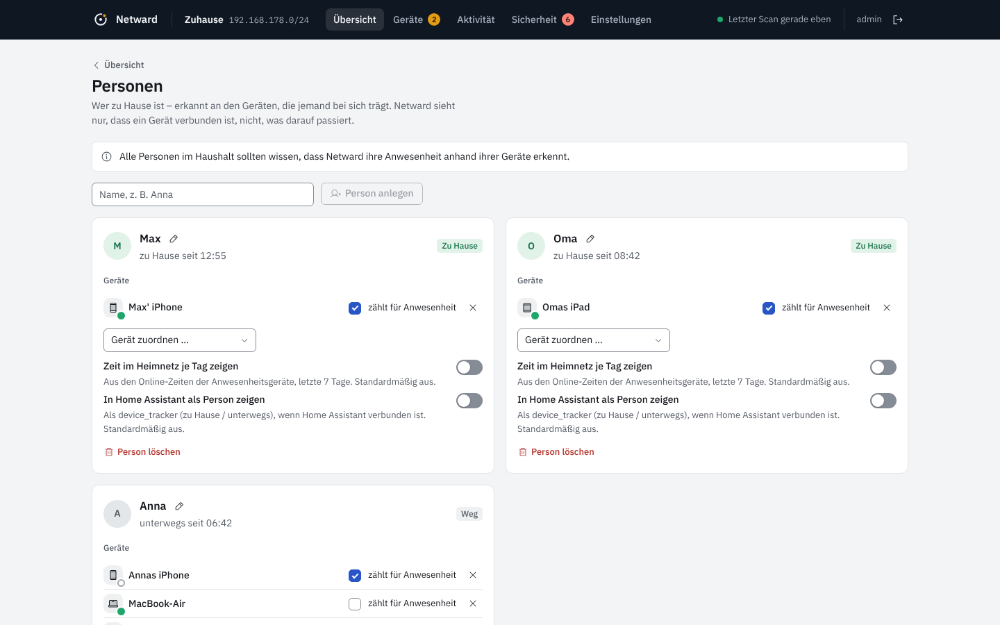

<p align="center">
  
</p>

<h1 align="center">Netward</h1>

<p align="center">
  Jedes Gerät in deinem Heimnetz im Blick. Selbst gehostet, ohne Cloud, ohne Abo.
</p>

<p align="center">
  <a href="https://github.com/Pyzyi/Netward/releases/latest"></a>
  <a href="https://github.com/Pyzyi/Netward/actions/workflows/ci.yml"></a>
  
  
</p>

<p align="center"><a href="README.md">English</a> · <b>Deutsch</b></p>


Netward findet alle Geräte in deinem Netz, gibt ihnen verständliche Namen und Symbole, zeigt, wer gerade
online ist, und meldet sich, wenn ein unbekanntes Gerät auftaucht oder das Internet ausfällt. Es läuft als
ein einziger, kleiner Docker-Container (≈ 23 MB) und ist für [ZimaOS](https://zimaspace.com) gebaut, läuft
aber auf jedem Linux-Host mit Docker.

## Funktionen

- **Geräteerkennung in Echtzeit.** Netward hört ARP, DHCP und mDNS passiv mit und scannt zusätzlich alle 90 Sekunden.
  Neue Geräte erscheinen nach Sekunden, nicht erst beim nächsten Scan.
- **Verständliche Namen und Gerätetypen.** Hersteller (IEEE-Register, wöchentlich aktualisiert), DHCP-Fingerprint,
  mDNS/Bonjour, UPnP, NetBIOS, Reverse-DNS und offene Ports ergeben Namen wie „Annas iPhone“ und 22 Gerätetypen.
- **Netzring und Herzschlag.** Die Übersicht zeigt dein Netz als Ring um den Router, jedes Gerät ein Punkt.
  In der Geräteliste zeigt ein Streifen pro Gerät die letzten 24 Stunden: wer immer da ist, wer abends kommt, wer fehlt.
- **Anwesenheit.** Zeitleiste pro Gerät (24 h, 7 und 30 Tage). Schlafende Handys werden gezielt geweckt, bevor
  Netward sie als offline meldet. Optional hilft die FRITZ!Box mit ihrer WLAN-Anmeldeliste.
- **Benachrichtigungen** über ntfy, Gotify, Pushover, Telegram, Discord, Slack/Mattermost, Webhook und E-Mail:
  neues Gerät, beobachtetes Gerät kommt oder geht, Internet weg und wieder da, IP-Konflikt, Sicherheitsbefund.
- **Home Assistant** per MQTT Discovery: beobachtete Geräte als `device_tracker`, dazu Sensoren für Geräteanzahl,
  neue Geräte und Internetstatus.
- **Software und Updates** (neu in 0.1). Netward zeigt, welches System auf einem Gerät läuft, soweit es das im
  Netz verrät, und ob es noch Sicherheitsupdates bekommt: Windows 10 und ältere Windows-11-Versionen, alte iPads und
  iPhones (aus dem Modell), macOS, Android, Debian/Raspberry Pi OS, Ubuntu, Synology DSM, Apple TV, FRITZ!OS mit
  verfügbarem Update. Veraltete Geräte werden zum Sicherheitsbefund mit Benachrichtigung und konkretem Rat.
  Was das Netz nicht verrät (z. B. die iOS-Version), kannst du am Gerät selbst angeben.
- **Bekannte, aktiv ausgenutzte Lücken** (neu in 0.2). Netward gleicht genaue Versionen von iOS, iPadOS, macOS und
  tvOS offline mit der CISA-Liste ausgenutzter Lücken ab und sagt, ab welcher Version sie geschlossen sind.
- **Sicherheitscheck.** Riskante offene Dienste (Telnet, SMB, RDP, unverschlüsselte Datenbanken …), UPnP am Router,
  IP-Konflikte, unbekannte Geräte. Neu in 0.2: ein zweiter DHCP-Server im Netz, ein anderes Gerät auf der
  Router-Adresse (ARP-Spoofing) und bekannte Geräte, die sich plötzlich als anderes System melden.
  Neu in 0.3.2: DNS-Server im Netz, die für bekannte Namen falsche Adressen liefern.
  Jeder Befund mit konkretem Tipp, was zu tun ist.
- **Stolperdraht** (neu in 0.3.2, einschaltbar). Köder-Dienste, die wie Telnet, Remotedesktop, ADB oder ein
  Kamera-Login aussehen. Kein normales Gerät spricht sie an; eine Verbindung ist ein starkes Zeichen für
  Schadsoftware oder jemanden, der sich umsieht – fast ohne Fehlalarme. Die Köder grüßen nur und speichern nichts.
- **WLAN-Karte** (neu in 0.3.2). Grundriss hochladen, mit dem Handy durch die Wohnung gehen und antippen, wo du
  stehst. Netward misst Tempo und Reaktionszeit zwischen Handy und Netward und zeichnet eine Karte mit Hinweisen
  wie „Im Kinderzimmer nur 38 Mbit/s, ein Verstärker im Flur würde helfen“. Ohne Zugriff auf den Router.
- **Geräte-Lebenslauf und Inventar** (neu in 0.3.2). Chronik je Gerät (erstmals gesehen, Systemwechsel, neue Ports,
  Updates, Ausfälle), die länger bleibt als der übrige Verlauf; dazu Kaufdatum, Garantie und Seriennummer.
- **Personen** (neu in 0.2). „Wer ist zu Hause“ anhand der Handys und Uhren, auf Wunsch je Person als
  `device_tracker` in Home Assistant. Die Zeit im Heimnetz je Tag nur, wenn die Person zugestimmt hat.
- **Internet-Monitor und Nachweis für den Provider.** Latenz und Ausfallhistorie; unterscheidet „Router weg“,
  „Internet weg“ und „nur DNS gestört“. Neu in 0.2: ein PDF-Bericht über einen Zeitraum mit Verfügbarkeit, allen
  Ausfällen, Latenz je Tag und – mit FRITZ!Box – den Sync-Raten gegen deine Vertragswerte, dazu die Rohdaten als CSV.
- **FRITZ!Box-Anbindung** (optional, TR-064): übernimmt die Namen, die du in der FRITZ!Box vergeben hast.
  Neu in 0.2: WLAN-Diagnose (welches Gerät hängt an welchem Repeater, in welchem Band, wie gut) und die
  Leitungsdaten (Sync-Raten, Neueinwahlen).
- **Werkzeuge:** Portscan pro Gerät, Wake-on-LAN, Geräte zusammenführen, CSV/JSON-Export.
- **Oberfläche:** ruhig und übersichtlich (neu gestaltet in 0.2.1), hell und dunkel, Deutsch und Englisch,
  funktioniert auf dem Handy und lässt sich zum Startbildschirm hinzufügen.

<table>
  <tr>
    <td></td>
    <td></td>
  </tr>
  <tr>
    <td></td>
    <td align="center"></td>
  </tr>
  <tr>
    <td></td>
    <td></td>
  </tr>
  <tr>
    <td></td>
    <td></td>
  </tr>
</table>

## Installation

### ZimaOS

1. App Store öffnen → oben rechts **„+“** → **„Benutzerdefinierte App installieren“** → **„Importieren“**.
2. Den Inhalt von [`docker-compose.yml`](docker-compose.yml) einfügen (unten noch einmal vollständig) und installieren.
3. `http://<IP-deines-ZimaOS>:8840` öffnen, Benutzer und Passwort festlegen. Fertig.

### CasaOS

Wie bei ZimaOS: App Store → **„+“** → **„Benutzerdefinierte App installieren“** → **„Importieren“** und die
Datei [`deploy/casaos/Netward/docker-compose.yml`](deploy/casaos/Netward/docker-compose.yml) einfügen.
Der Eintrag für den offiziellen App Store ist vorbereitet.

### Unraid

Bis Netward in den Community Applications steht, im Unraid-Terminal die Vorlage laden:

```bash
wget -O /boot/config/plugins/dockerMan/templates-user/my-netward.xml \
  https://raw.githubusercontent.com/Pyzyi/Netward/main/deploy/unraid/netward.xml
```

Danach **Docker → Container hinzufügen → Vorlage „netward“** wählen und anwenden.

### TrueNAS SCALE (24.10 und neuer)

**Apps → Apps entdecken → ⋮ → Per YAML installieren**, Namen `netward` vergeben und
[`deploy/truenas/netward.yaml`](deploy/truenas/netward.yaml) einfügen. Den Pfad `/mnt/tank/apps/netward`
vorher an deinen Pool anpassen und den Ordner anlegen.

### Jeder andere Docker-Host

```bash
mkdir netward && cd netward
curl -fsSLO https://raw.githubusercontent.com/Pyzyi/Netward/main/docker-compose.yml
docker compose up -d
```

Auf anderen Systemen als ZimaOS den Datenpfad `/DATA/AppData/netward` anpassen, z. B. auf `./data`.

<details>
<summary><b>docker-compose.yml</b> zum Kopieren</summary>

```yaml
name: netward

services:
  netward:
    image: ghcr.io/pyzyi/netward:latest
    container_name: netward
    restart: unless-stopped
    network_mode: host
    cap_drop:
      - ALL
    cap_add:
      - CHOWN
      - SETUID
      - SETGID
      - NET_RAW
    security_opt:
      - no-new-privileges:true
    read_only: true
    environment:
      TZ: Europe/Berlin
      NETWARD_PORT: "8840"
    volumes:
      - /DATA/AppData/netward:/data
```

</details>

### Ersteinrichtung

Die Einrichtungsseite ist aus Sicherheitsgründen nur **30 Minuten nach dem Start** und nur **aus dem lokalen Netz**
erreichbar. Wer das verpasst, startet den Container einfach neu. Es gibt kein Standardpasswort.

### Updates

Neue Versionen erscheinen unter [Releases](https://github.com/Pyzyi/Netward/releases) mit einer Beschreibung, was
neu ist. Das Image-Tag `latest` zeigt immer auf das neueste Release, `0.3` auf die neueste 0.3.x-Version.
Zwischenstände der Entwicklung heißen `edge` und sind nicht für den Alltag gedacht.

**Aktualisieren ohne Neuinstallation** – Geräte, Namen, Verlauf, Konten und Einstellungen bleiben erhalten:

- **ZimaOS / CasaOS:** Am zuverlässigsten: In den Einstellungen der App beim Image die Versionsnummer eintragen
  (z. B. `ghcr.io/pyzyi/netward:0.4.1` statt `latest`) und speichern. Dann muss ZimaOS die neue Version laden.
  Mit `latest` die App neu erstellen bzw. das Image neu laden (je nach ZimaOS-Version „Update“, „Rebuild“ oder
  Speichern ohne Änderung).
- **Unraid:** auf der Docker-Seite „Nach Updates suchen“.
- **TrueNAS:** App bearbeiten und speichern; mit Versionsnummer im Image die Nummer ändern.
  Ob ZimaOS bei selbst eingefügten Compose-Apps von sich aus ein Update anzeigt, hängt von der ZimaOS-Version ab.
  Zuverlässig ist der Hinweis in Netward selbst (siehe unten).
- **Docker Compose:** im Ordner mit der `docker-compose.yml`: `docker compose pull && docker compose up -d`.

Die Datenbank wird beim Start automatisch migriert. Vorher legt Netward eine Kopie im Unterordner `backup` an
(`pre-update-schema-N.db`). Zurück auf eine ältere Version geht nur mit dieser Kopie, weil eine ältere Version eine
neuere Datenbank nicht öffnet. Zusätzlich entsteht einmal täglich eine Sicherung (die letzten drei bleiben erhalten).

**Hinweis auf neue Versionen:** Unter *Einstellungen → Über Netward* lässt sich „Nach neuen Versionen suchen“
einschalten (standardmäßig aus). Netward fragt dann einmal am Tag bei GitHub nach und zeigt einen Link zu den
Release-Notizen. Es installiert nichts selbst: Dafür bräuchte der Container Zugriff auf Docker, und das wäre ein
größeres Risiko als der Nutzen.

## Warum diese Rechte?

Netward braucht `network_mode: host`, weil Geräteerkennung auf Layer 2 (ARP, DHCP) nur im Netz des Hosts möglich ist.
Fing Agent und NetAlertX haben dieselbe Anforderung. Der Unterschied liegt in dem, was danach passiert:

| | Netward | übliche Netzwerk-Scanner |
|---|---|---|
| Benutzer im Betrieb | UID 10001 | root |
| Linux-Capabilities im Betrieb | **keine** (`CapEff = 0`) | `NET_ADMIN`, `NET_RAW`, oft `privileged` |
| Dateisystem | schreibgeschützt, nur `/data` beschreibbar | beschreibbar |
| Inhalt des Images | ein statisches Programm, keine Shell, kein Paketmanager | komplette Distribution |
| Zugangsschutz | Pflicht-Einrichtung, Argon2id, Brute-Force-Bremse | teils Standardpasswort |

Beim Start öffnet Netward als root genau zwei Sockets, übergibt `/data` an den Laufzeit-Benutzer und gibt dann
**alle** Rechte unwiderruflich ab. `CHOWN`, `SETUID` und `SETGID` werden nur für diesen Wechsel gebraucht.
Ohne `NET_RAW` läuft Netward weiter, erkennt Geräte dann aber langsamer und nur im eigenen /24-Netz.

Optional: `NET_BIND_SERVICE` braucht es nur für Stolperdraht-Köder auf Ports unter 1024 (z. B. 23 oder 445, siehe
`NETWARD_TRIPWIRE_PORTS`). Sie werden vor dem Wechsel geöffnet; der laufende Prozess hat trotzdem keine Capabilities.

Mehr dazu: [Sicherheitsrichtlinie](SECURITY.md) · [Bedrohungsmodell](docs/03-bedrohungsmodell.md)

## Einstellungen per Umgebungsvariable

Alles Weitere stellst du in der Oberfläche ein. Diese Variablen braucht man nur in Sonderfällen:

| Variable | Standard | Zweck |
|---|---|---|
| `NETWARD_PORT` | `8840` | Port der Weboberfläche |
| `NETWARD_LISTEN` | alle Adressen | nur auf einer bestimmten IP lauschen, z. B. `192.168.178.10` |
| `NETWARD_INTERFACES` | automatisch | Netzwerkschnittstellen, z. B. `eth0,eth1` |
| `NETWARD_ALLOWED_HOSTS` | – | zusätzliche Hostnamen, unter denen Netward erreichbar ist (Reverse-Proxy) |
| `NETWARD_TRUSTED_PROXIES` | – | IPs/Netze deines Reverse-Proxys, damit Netward die echte Client-IP sieht |
| `NETWARD_TLS_CERT`, `NETWARD_TLS_KEY` | – | HTTPS direkt in Netward (Pfade im Container) |
| `NETWARD_SETUP_TOKEN` | – | Ersteinrichtung zusätzlich mit einem Token absichern |
| `PUID`, `PGID` | `10001` | Benutzer, dem der Datenordner gehört |
| `NETWARD_LOG_LEVEL` | `info` | `debug`, `info`, `warn`, `error` |
| `NETWARD_DEMO` | – | `1` (deutsch) oder `en` (englisch) startet mit Beispieldaten ohne zu scannen |
| `NETWARD_TRIPWIRE_PORTS` | – | Stolperdraht-Köder, die beim Start geöffnet werden, z. B. `23,445` (Ports unter 1024 brauchen `cap_add: NET_BIND_SERVICE`) |

Netward antwortet nur auf IP-Adressen, `localhost` und lokale Namen (`.local`, `.lan`, `.home.arpa`, `.fritz.box` …).
Andere Hostnamen müssen in `NETWARD_ALLOWED_HOSTS` stehen. Das schützt vor DNS-Rebinding-Angriffen aus dem Browser.

## Passwort vergessen?

```bash
docker exec netward /netward reset-password
```

Ohne Terminal (z. B. unter ZimaOS über die Dateien-App): im Datenordner `/DATA/AppData/netward` eine leere Datei
namens `reset-password` anlegen und die App neu starten. Das neue Passwort steht dann im Protokoll der App.
Eine leere Datei `factory-reset` setzt Konto, Benachrichtigungskanäle und Einstellungen zurück, die Geräte bleiben.

## Häufige Fragen

**Kann Netward Geräte sperren wie die Fingbox?** Nein, mit Absicht. Das ginge nur über ARP-Spoofing, also einen
Angriff auf das eigene Netz. Sperren gehört in den Router (FRITZ!Box: Kindersicherung / Zugangsprofile).

**Warum taucht mein iPhone mehrfach auf?** iOS und Android verwenden pro WLAN eine private, gelegentlich wechselnde
MAC-Adresse. Netward kennzeichnet solche Adressen; in der Detailansicht lassen sich Einträge zusammenführen.
Unbekannte Geräte mit privater Adresse verschwinden nach 14 Tagen offline von selbst.

**Werden Daten nach außen gesendet?** Nein. Keine Telemetrie, keine Cloud. Netward verbindet sich nur mit Zielen,
die du selbst einträgst (Benachrichtigungen, MQTT, FRITZ!Box), für den Internet-Monitor mit `1.1.1.1:443`,
`9.9.9.9:443` und `dns.google:443` (änderbar oder abschaltbar) und – nur wenn du es einschaltest – einmal täglich
mit GitHub, um nach neuen Versionen zu fragen. Die Software-Bewertung arbeitet mit einer eingebauten Wissensbasis
(Datenstand steht in der Oberfläche) und fragt keinen Online-Dienst. Der Sicherheitscheck fragt außerdem die
DNS-Server in deinem Netz nach `one.one.one.one`, `dns.google`, `dns.quad9.net` und einem zufälligen Namen unter
`example.com` (abschaltbar); dein DNS-Server leitet diese Fragen eventuell ins Internet weiter.

**Woher weiß Netward, welche Software ein Gerät hat?** Aus dem, was Geräte im Netz von sich aus ankündigen
(mDNS, UPnP, DHCP), von der FRITZ!Box, und im Sicherheitscheck aus zwei Abfragen: der Begrüßungszeile eines
SSH-Servers (es wird nichts gesendet) und der Versionsangabe, die Windows beim ersten Schritt einer Dateifreigabe-
Anmeldung nennt. Die Anmeldung wird nie abgeschlossen, es werden keine Zugangsdaten gesendet. iPhones verraten
ihre iOS-Version grundsätzlich nicht; dort hilft das Modell („kann höchstens iOS 16“) oder deine Angabe.
Details: [docs/08](docs/08-software-und-support.md).

**Was macht der Stolperdraht genau?** Eingeschaltet (*Einstellungen → Scannen*) lauscht Netward auf ein paar
Ports, die im Heimnetz niemand benutzen sollte: standardmäßig 2323 (Telnet), 3389 (Remotedesktop), 5555
(Android-Debugging), 5900 (VNC); weitere lassen sich ergänzen, etwa 8888 für einen falschen Kamera-Login. Verbindet sich ein Gerät aus deinem Netz, gibt es einen
kritischen Befund und eine Benachrichtigung. Eigene Scanner lassen sich per IP oder Netz ausnehmen. Verbindungen aus
dem Internet (Portweiterleitung) und vom Netward-Rechner selbst zählen nie.

**Was misst die WLAN-Karte?** Die Strecke zwischen deinem Handy und Netward: Reaktionszeit, Download und Upload,
etwa zehn Sekunden je Stelle. Hängt Netward am Kabel, zeigt das die Qualität deines WLANs. Das Internet-Tempo
misst die Karte nicht, und sie sendet nichts an fremde Server.

**Mehrere Netze/VLANs?** Netward sieht jedes Netz, in dem der Host eine Schnittstelle hat. Hinter Routern liegende
Netze sind auf Layer 2 nicht sichtbar.

## Entwicklung

Voraussetzungen: Go 1.27, Node 22.

```bash
make build      # Oberfläche bauen, Programm nach bin/netward
make test       # go vet + Tests mit Race-Detector
make fuzz       # Fuzzing der Protokoll-Parser (FUZZTIME=30s)
make demo       # mit Beispieldaten auf http://localhost:8840
```

Für die Oberfläche mit Hot-Reload: `make demo` mit `NETWARD_PORT=18840` starten und in `web/` `npm run dev` ausführen.
Container- und UI-Tests liegen in [`e2e/`](e2e) (`sudo e2e/container-test.sh`, `cd e2e && npx playwright test`).

## Projektunterlagen

Netward wurde wie ein Teamprojekt geplant und geprüft, mit dem Qualitätsmodell ISO/IEC 25010 als Maßstab:

1. [Anforderungen und Wettbewerbsanalyse](docs/01-anforderungen.md)
2. [Architektur und Architekturentscheidungen](docs/02-architektur.md)
3. [Bedrohungsmodell (STRIDE)](docs/03-bedrohungsmodell.md)
4. [Qualitätsmodell nach ISO/IEC 25010](docs/04-qualitaetsmodell-iso25010.md)
5. [UX- und Designkonzept](docs/05-ux-design.md)
6. [Teststrategie](docs/06-teststrategie.md)
7. [Review-Protokoll](docs/07-review-protokoll.md)
8. [Software und Support (0.1)](docs/08-software-und-support.md)
9. [Version 0.2](docs/09-version-0.2.md) · [Version 0.3.2](docs/10-version-0.3.md) · [Änderungen](CHANGELOG.md)

## Lizenz

[MIT](LICENSE). Verwendete Bibliotheken, Schriften und Daten: [NOTICE](NOTICE).
