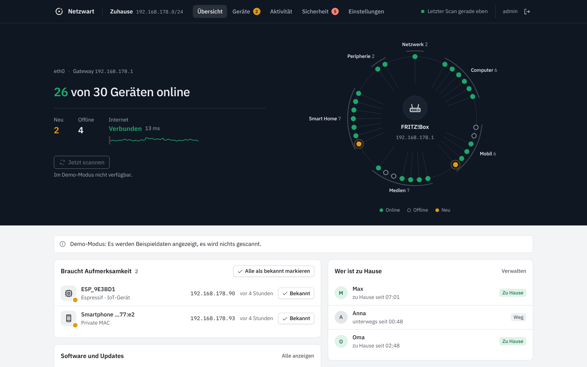
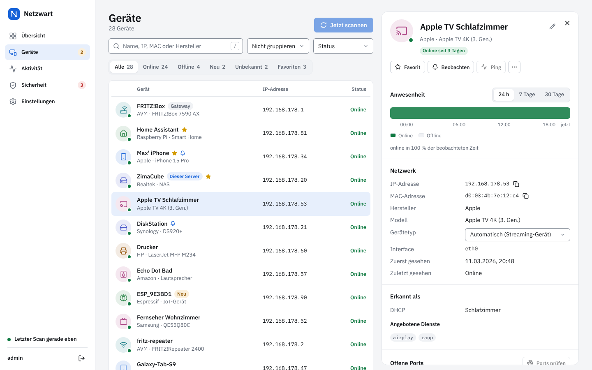
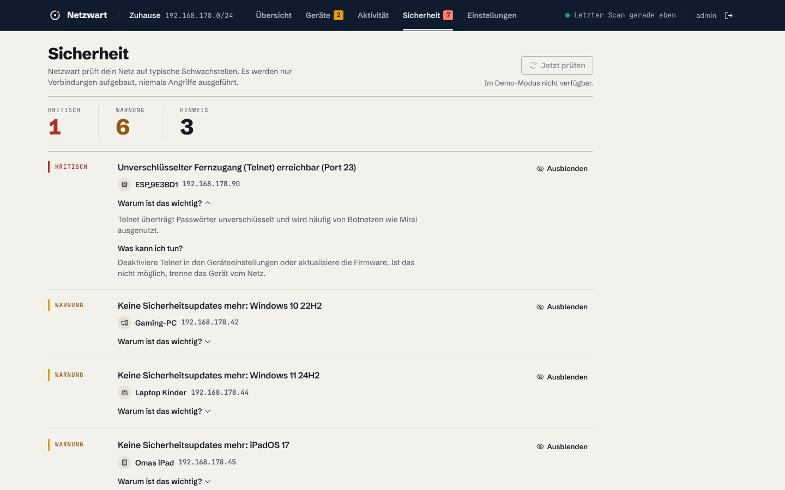
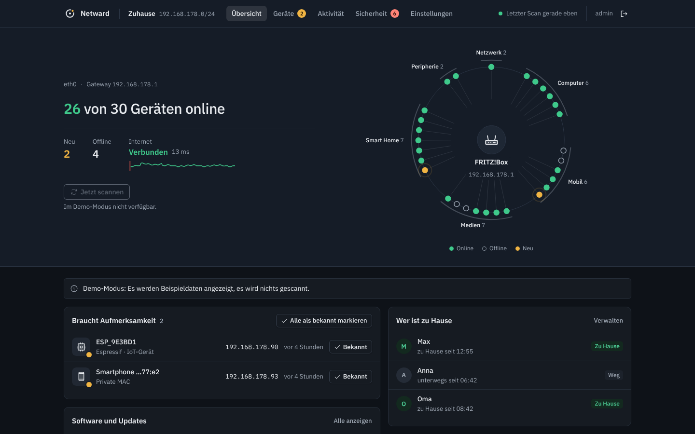
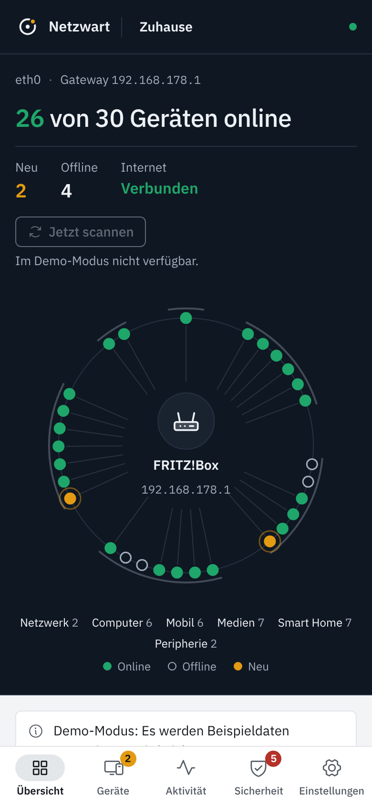

<p align="center">
  
</p>

<h1 align="center">Netzwart</h1>

<p align="center">
  Jedes Gerät in deinem Heimnetz im Blick. Selbst gehostet, ohne Cloud, ohne Abo.
</p>

<p align="center">
  <a href="https://github.com/Pyzyi/netzwart/actions/workflows/ci.yml"></a>
  
  
</p>



Netzwart findet alle Geräte in deinem Netz, gibt ihnen verständliche Namen und Symbole, zeigt, wer gerade
online ist, und meldet sich, wenn ein unbekanntes Gerät auftaucht oder das Internet ausfällt. Es läuft als
ein einziger, kleiner Docker-Container (≈ 23 MB) und ist für [ZimaOS](https://zimaspace.com) gebaut, läuft
aber auf jedem Linux-Host mit Docker.

## Funktionen

- **Geräteerkennung in Echtzeit.** Netzwart hört ARP, DHCP und mDNS passiv mit und scannt zusätzlich alle 90 Sekunden.
  Neue Geräte erscheinen nach Sekunden, nicht erst beim nächsten Scan.
- **Verständliche Namen und Gerätetypen.** Hersteller (IEEE-Register, wöchentlich aktualisiert), DHCP-Fingerprint,
  mDNS/Bonjour, UPnP, NetBIOS, Reverse-DNS und offene Ports ergeben Namen wie „Annas iPhone“ und 22 Gerätetypen.
- **Anwesenheit.** Zeitleiste pro Gerät (24 h, 7 und 30 Tage). Schlafende Handys werden gezielt geweckt, bevor
  Netzwart sie als offline meldet. Optional hilft die FRITZ!Box mit ihrer WLAN-Anmeldeliste.
- **Benachrichtigungen** über ntfy, Gotify, Pushover, Telegram, Discord, Slack/Mattermost, Webhook und E-Mail:
  neues Gerät, beobachtetes Gerät kommt oder geht, Internet weg und wieder da, IP-Konflikt, Sicherheitsbefund.
- **Home Assistant** per MQTT Discovery: beobachtete Geräte als `device_tracker`, dazu Sensoren für Geräteanzahl,
  neue Geräte und Internetstatus.
- **Sicherheitscheck.** Riskante offene Dienste (Telnet, SMB, RDP, unverschlüsselte Datenbanken …), UPnP am Router,
  IP-Konflikte, unbekannte Geräte. Jeder Befund mit konkretem Tipp, was zu tun ist.
- **Internet-Monitor.** Latenz der letzten 24 Stunden und Ausfallhistorie. Unterscheidet „Router weg“, „Internet weg“
  und „nur DNS gestört“.
- **FRITZ!Box-Anbindung** (optional, TR-064): übernimmt die Namen, die du in der FRITZ!Box vergeben hast.
- **Werkzeuge:** Portscan pro Gerät, Wake-on-LAN, Geräte zusammenführen, CSV/JSON-Export.
- **Oberfläche:** hell und dunkel, Deutsch und Englisch, funktioniert auf dem Handy und lässt sich zum
  Startbildschirm hinzufügen.

<table>
  <tr>
    <td></td>
    <td></td>
  </tr>
  <tr>
    <td></td>
    <td align="center"></td>
  </tr>
</table>

## Installation

### ZimaOS

1. App Store öffnen → oben rechts **„+“** → **„Benutzerdefinierte App installieren“** → **„Importieren“**.
2. Den Inhalt von [`docker-compose.yml`](docker-compose.yml) einfügen (unten noch einmal vollständig) und installieren.
3. `http://<IP-deines-ZimaOS>:8840` öffnen, Benutzer und Passwort festlegen. Fertig.

### Jeder andere Docker-Host

```bash
mkdir netzwart && cd netzwart
curl -fsSLO https://raw.githubusercontent.com/Pyzyi/netzwart/main/docker-compose.yml
docker compose up -d
```

Auf anderen Systemen als ZimaOS den Datenpfad `/DATA/AppData/netzwart` anpassen, z. B. auf `./data`.

<details>
<summary><b>docker-compose.yml</b> zum Kopieren</summary>

```yaml
name: netzwart

services:
  netzwart:
    image: ghcr.io/pyzyi/netzwart:latest
    container_name: netzwart
    restart: unless-stopped
    network_mode: host
    cap_drop:
      - ALL
    cap_add:
      - CHOWN
      - SETUID
      - SETGID
      - NET_RAW
    security_opt:
      - no-new-privileges:true
    read_only: true
    environment:
      TZ: Europe/Berlin
      NETZWART_PORT: "8840"
    volumes:
      - /DATA/AppData/netzwart:/data
```

</details>

### Ersteinrichtung

Die Einrichtungsseite ist aus Sicherheitsgründen nur **30 Minuten nach dem Start** und nur **aus dem lokalen Netz**
erreichbar. Wer das verpasst, startet den Container einfach neu. Es gibt kein Standardpasswort.

### Updates

ZimaOS zeigt Updates im App Store an. Mit Docker Compose: `docker compose pull && docker compose up -d`.
Die Datenbank wird automatisch migriert; einmal täglich entsteht eine Sicherung im Unterordner `backup` (die letzten drei bleiben erhalten).

## Warum diese Rechte?

Netzwart braucht `network_mode: host`, weil Geräteerkennung auf Layer 2 (ARP, DHCP) nur im Netz des Hosts möglich ist.
Fing Agent und NetAlertX haben dieselbe Anforderung. Der Unterschied liegt in dem, was danach passiert:

| | Netzwart | übliche Netzwerk-Scanner |
|---|---|---|
| Benutzer im Betrieb | UID 10001 | root |
| Linux-Capabilities im Betrieb | **keine** (`CapEff = 0`) | `NET_ADMIN`, `NET_RAW`, oft `privileged` |
| Dateisystem | schreibgeschützt, nur `/data` beschreibbar | beschreibbar |
| Inhalt des Images | ein statisches Programm, keine Shell, kein Paketmanager | komplette Distribution |
| Zugangsschutz | Pflicht-Einrichtung, Argon2id, Brute-Force-Bremse | teils Standardpasswort |

Beim Start öffnet Netzwart als root genau zwei Sockets, übergibt `/data` an den Laufzeit-Benutzer und gibt dann
**alle** Rechte unwiderruflich ab. `CHOWN`, `SETUID` und `SETGID` werden nur für diesen Wechsel gebraucht.
Ohne `NET_RAW` läuft Netzwart weiter, erkennt Geräte dann aber langsamer und nur im eigenen /24-Netz.

Mehr dazu: [Sicherheitsrichtlinie](SECURITY.md) · [Bedrohungsmodell](docs/03-bedrohungsmodell.md)

## Einstellungen per Umgebungsvariable

Alles Weitere stellst du in der Oberfläche ein. Diese Variablen braucht man nur in Sonderfällen:

| Variable | Standard | Zweck |
|---|---|---|
| `NETZWART_PORT` | `8840` | Port der Weboberfläche |
| `NETZWART_LISTEN` | alle Adressen | nur auf einer bestimmten IP lauschen, z. B. `192.168.178.10` |
| `NETZWART_INTERFACES` | automatisch | Netzwerkschnittstellen, z. B. `eth0,eth1` |
| `NETZWART_ALLOWED_HOSTS` | – | zusätzliche Hostnamen, unter denen Netzwart erreichbar ist (Reverse-Proxy) |
| `NETZWART_TRUSTED_PROXIES` | – | IPs/Netze deines Reverse-Proxys, damit Netzwart die echte Client-IP sieht |
| `NETZWART_TLS_CERT`, `NETZWART_TLS_KEY` | – | HTTPS direkt in Netzwart (Pfade im Container) |
| `NETZWART_SETUP_TOKEN` | – | Ersteinrichtung zusätzlich mit einem Token absichern |
| `PUID`, `PGID` | `10001` | Benutzer, dem der Datenordner gehört |
| `NETZWART_LOG_LEVEL` | `info` | `debug`, `info`, `warn`, `error` |
| `NETZWART_DEMO` | – | `1` startet mit Beispieldaten ohne zu scannen |

Netzwart antwortet nur auf IP-Adressen, `localhost` und lokale Namen (`.local`, `.lan`, `.home.arpa`, `.fritz.box` …).
Andere Hostnamen müssen in `NETZWART_ALLOWED_HOSTS` stehen. Das schützt vor DNS-Rebinding-Angriffen aus dem Browser.

## Passwort vergessen?

```bash
docker exec netzwart /netzwart reset-password
```

Ohne Terminal (z. B. unter ZimaOS über die Dateien-App): im Datenordner `/DATA/AppData/netzwart` eine leere Datei
namens `reset-password` anlegen und die App neu starten. Das neue Passwort steht dann im Protokoll der App.
Eine leere Datei `factory-reset` setzt Konto, Benachrichtigungskanäle und Einstellungen zurück, die Geräte bleiben.

## Häufige Fragen

**Kann Netzwart Geräte sperren wie die Fingbox?** Nein, mit Absicht. Das ginge nur über ARP-Spoofing, also einen
Angriff auf das eigene Netz. Sperren gehört in den Router (FRITZ!Box: Kindersicherung / Zugangsprofile).

**Warum taucht mein iPhone mehrfach auf?** iOS und Android verwenden pro WLAN eine private, gelegentlich wechselnde
MAC-Adresse. Netzwart kennzeichnet solche Adressen; in der Detailansicht lassen sich Einträge zusammenführen.
Unbekannte Geräte mit privater Adresse verschwinden nach 14 Tagen offline von selbst.

**Werden Daten nach außen gesendet?** Nein. Keine Telemetrie, keine Cloud. Netzwart verbindet sich nur mit Zielen,
die du selbst einträgst (Benachrichtigungen, MQTT, FRITZ!Box), und für den Internet-Monitor mit `1.1.1.1:443`,
`9.9.9.9:443` und `dns.google:443` (änderbar oder abschaltbar).

**Mehrere Netze/VLANs?** Netzwart sieht jedes Netz, in dem der Host eine Schnittstelle hat. Hinter Routern liegende
Netze sind auf Layer 2 nicht sichtbar.

## Entwicklung

Voraussetzungen: Go 1.27, Node 22.

```bash
make build      # Oberfläche bauen, Programm nach bin/netzwart
make test       # go vet + Tests mit Race-Detector
make fuzz       # Fuzzing der Protokoll-Parser (FUZZTIME=30s)
make demo       # mit Beispieldaten auf http://localhost:8840
```

Für die Oberfläche mit Hot-Reload: `make demo` mit `NETZWART_PORT=18840` starten und in `web/` `npm run dev` ausführen.
Container- und UI-Tests liegen in [`e2e/`](e2e) (`sudo e2e/container-test.sh`, `cd e2e && npx playwright test`).

## Projektunterlagen

Netzwart wurde wie ein Teamprojekt geplant und geprüft, mit dem Qualitätsmodell ISO/IEC 25010 als Maßstab:

1. [Anforderungen und Wettbewerbsanalyse](docs/01-anforderungen.md)
2. [Architektur und Architekturentscheidungen](docs/02-architektur.md)
3. [Bedrohungsmodell (STRIDE)](docs/03-bedrohungsmodell.md)
4. [Qualitätsmodell nach ISO/IEC 25010](docs/04-qualitaetsmodell-iso25010.md)
5. [UX- und Designkonzept](docs/05-ux-design.md)
6. [Teststrategie](docs/06-teststrategie.md)
7. [Review-Protokoll](docs/07-review-protokoll.md)

## Lizenz

[MIT](LICENSE). Verwendete Bibliotheken, Schriften und Daten: [NOTICE](NOTICE).
