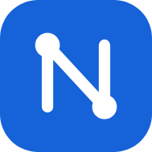
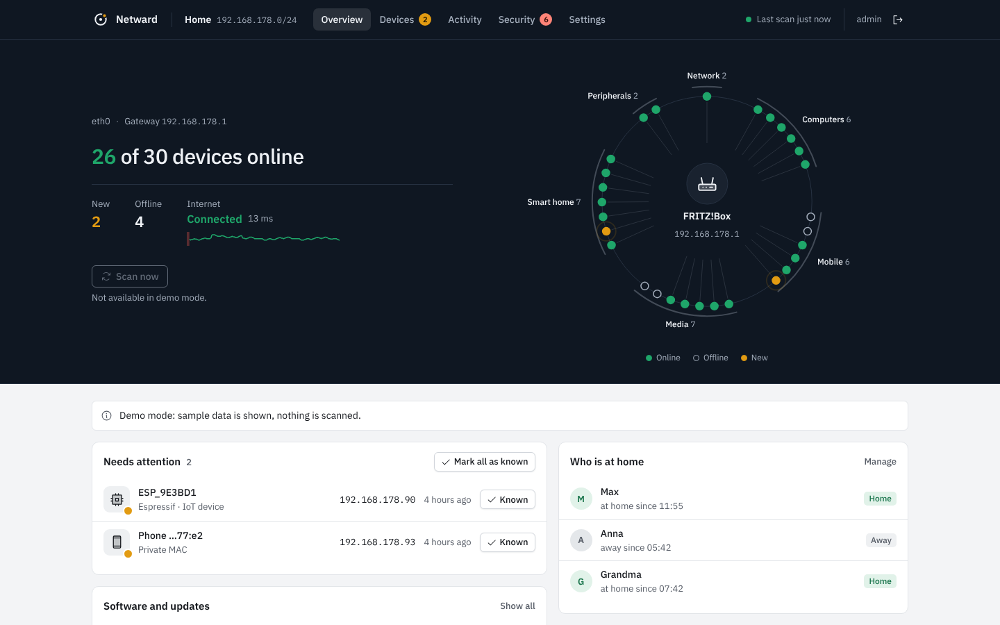
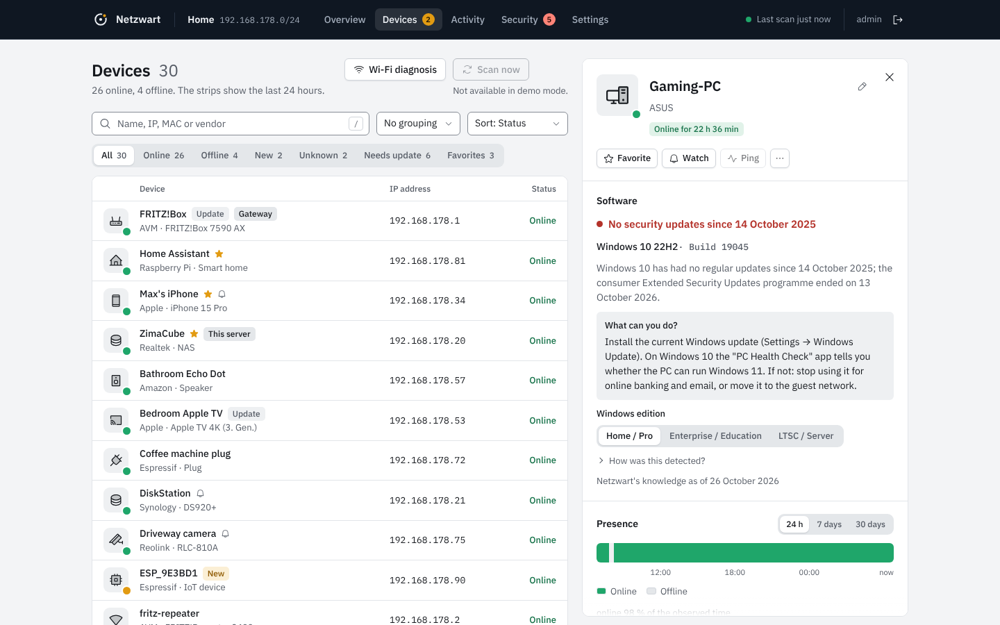
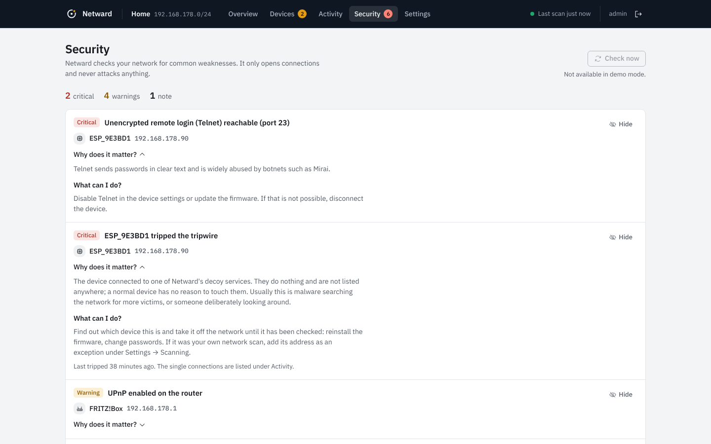
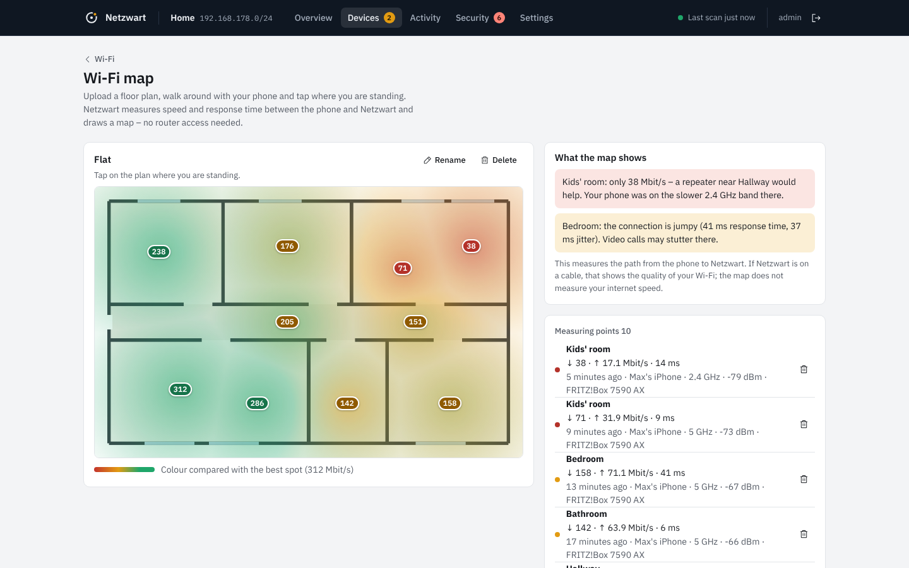
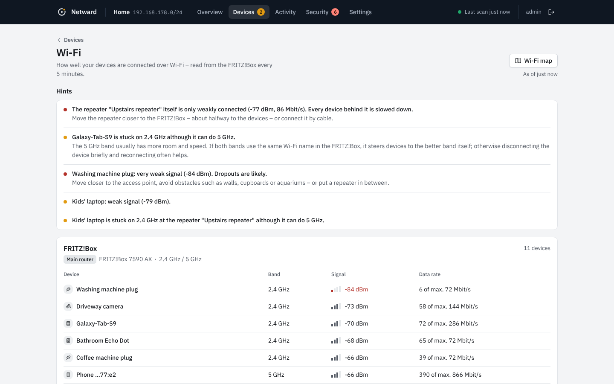
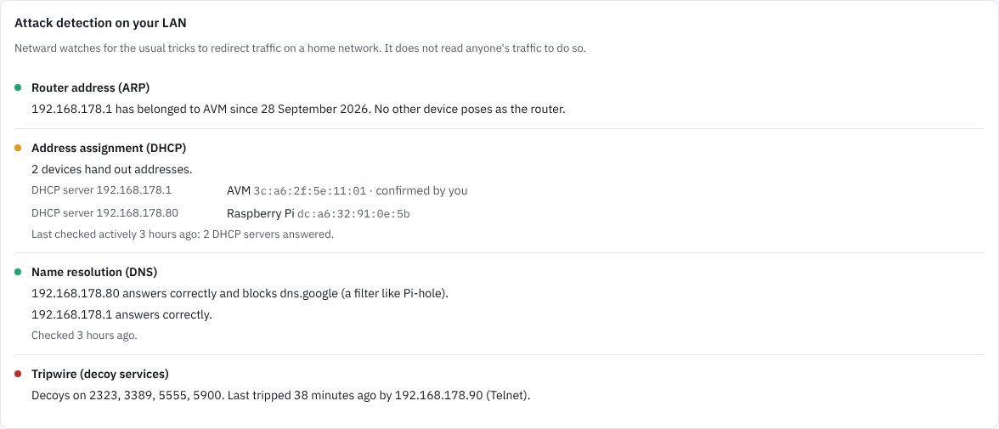
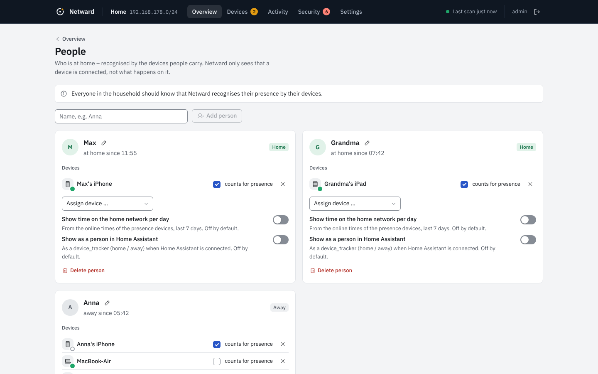
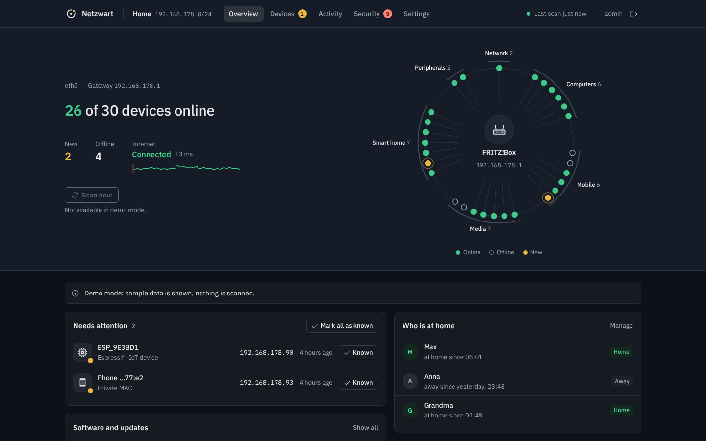
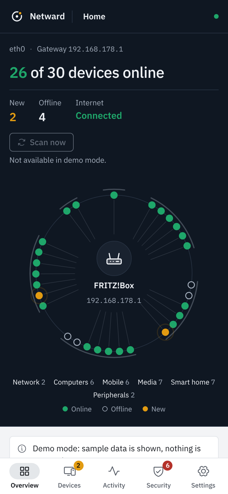

<p align="center">
  
</p>

<h1 align="center">Netward</h1>

<p align="center">
  <b>See every device on your home network.</b><br>
  A self-hosted network monitor with security checks. No cloud, no subscription, no telemetry.
</p>

<p align="center">
  <a href="https://github.com/Pyzyi/Netward/releases/latest"></a>
  <a href="https://github.com/Pyzyi/Netward/actions/workflows/ci.yml"></a>
  <a href="https://github.com/Pyzyi/Netward/pkgs/container/netward"></a>
  
  
</p>

<p align="center"><b>English</b> · <a href="README.de.md">Deutsch</a></p>



Netward finds every device on your network and gives it a readable name and icon. It shows who is online and
tells you when an unknown device appears or the internet goes down. It also checks your network for the usual
weak spots: open Telnet, devices without security updates, a rogue DHCP server and more.

It runs as one small container (about 23 MB) with a read-only file system and **no Linux capabilities at runtime**.
It was built for [ZimaOS](https://zimaspace.com) and runs on any Linux host with Docker: CasaOS, Unraid, TrueNAS SCALE,
Synology, a Raspberry Pi.

## Why Netward

- **Answers first.** The overview tells you in one sentence how many devices are online, what is new and whether
  the internet is fine. The network ring shows your whole home at a glance, with the router in the centre.
- **Real names, not MAC addresses.** Names, types and vendors come from DHCP, mDNS/Bonjour, UPnP, NetBIOS, reverse DNS,
  the IEEE vendor registry and open ports. You get "Living room TV" and "Anna's iPhone" instead of `a4:83:e7:…`.
- **Security you can act on.** Every finding says why it matters and what to do, in plain language.
- **Private by design.** Nothing leaves your network unless you set it up (notifications, MQTT, update check).
- **Small and locked down.** One static binary, no shell in the image, mandatory setup with Argon2id. It drops
  to an unprivileged user after opening its sockets.

## Features

- **Live discovery.** Passive ARP, DHCP and mDNS listening plus a scan every 90 seconds. New devices show up within
  seconds, not at the next scan.
- **Network ring and heartbeat.** The overview draws your network as a ring around the router. The device list
  shows the last 24 hours per device as a strip: who is always there, who comes home in the evening, who is missing.
- **Presence.** Timeline per device (24 h, 7 and 30 days). Sleeping phones are woken up before they are reported
  offline.
- **People.** "Who is at home", based on phones and watches. Optionally each person appears as a `device_tracker`
  in Home Assistant. Time at home per day is only recorded with the person's consent.
- **Notifications** via ntfy, Gotify, Pushover, Telegram, Discord, Slack/Mattermost, webhook and e-mail. Netward
  notifies you about:
  - new devices
  - watched devices coming or going
  - internet outages
  - IP conflicts
  - security findings
- **Home Assistant** via MQTT discovery: device trackers and sensors for device count, new devices and internet
  status.
- **Security check:**
  - risky open services: Telnet, SMB, RDP, unencrypted databases …
  - UPnP on the router, IP conflicts, unknown devices
  - a second DHCP server, ARP spoofing of the router address, and known devices that suddenly identify as a
    different system
  - DNS servers on your network that return wrong addresses for well-known names
- **Tripwire** (opt-in). Decoy services that look like Telnet, remote desktop, ADB or a camera login. No normal
  device ever touches them, so a connection is a strong sign of malware or of someone looking around, with almost
  no false alarms. The decoys only greet and keep nothing that is sent.
- **Wi-Fi map.** Upload a floor plan, walk around with your phone and tap where you stand. Netward measures speed
  and response time between the phone and itself and draws a heatmap with advice like *"Kids' room: only
  38 Mbit/s – a repeater near the hallway would help."* No router access needed.
- **Device history and inventory.** A timeline per device (first seen, new system, new ports, updates, outages)
  that outlives the event retention, plus purchase date, warranty and serial number for small offices.
- **Software and updates.** Netward shows which system a device runs, as far as it reveals it on the network, and
  whether that system still receives security updates. This covers Windows 10/11, iOS and iPadOS by model, macOS,
  Android, Debian, Ubuntu, Synology DSM and FRITZ!OS.
- **Known exploited vulnerabilities.** Exact iOS, iPadOS, macOS and tvOS versions are checked offline against the
  CISA KEV catalogue. Netward tells you which version fixes them.
- **Internet monitor and evidence for your ISP.** Latency and outage history that tells "router down", "internet
  down" and "only DNS broken" apart. The PDF report lists availability, every outage and daily latency, with raw
  data as CSV.
- **FRITZ!Box integration** (optional, TR-064):
  - device names from the router
  - Wi-Fi diagnosis: which device is on which repeater, in which band, how well
  - line sync rates
- **Tools:** port scan per device, Wake-on-LAN, merge duplicates, CSV/JSON export.
- **Interface:** light and dark, English and German, works on phones and can be added to the home screen.

<table>
  <tr>
    <td></td>
    <td></td>
  </tr>
  <tr>
    <td></td>
    <td></td>
  </tr>
  <tr>
    <td></td>
    <td></td>
  </tr>
  <tr>
    <td></td>
    <td align="center"></td>
  </tr>
</table>

## Quick start

```bash
mkdir netward && cd netward
curl -fsSLO https://raw.githubusercontent.com/Pyzyi/Netward/main/docker-compose.yml
# change the data path /DATA/AppData/netward to e.g. ./data
docker compose up -d
```

Open `http://<server-ip>:8840` and create your account. There is no default password.

<details>
<summary><b>docker-compose.yml</b></summary>

```yaml
name: netward

services:
  netward:
    image: ghcr.io/pyzyi/netward:latest
    container_name: netward
    restart: unless-stopped
    network_mode: host          # layer-2 discovery needs the host network
    cap_drop:
      - ALL
    cap_add:                    # only used during start-up, dropped afterwards
      - CHOWN
      - SETUID
      - SETGID
      - NET_RAW
    security_opt:
      - no-new-privileges:true
    read_only: true
    environment:
      TZ: Europe/London
      NETWARD_PORT: "8840"
    volumes:
      - ./data:/data
```

</details>

## Installation on NAS systems

| Platform | How |
|---|---|
| **ZimaOS / CasaOS** | App Store → **+** → *Install a customized app* → *Import*. Paste [`deploy/casaos/Netward/docker-compose.yml`](deploy/casaos/Netward/docker-compose.yml). A listing for the official app store is prepared. |
| **Unraid** | Until Netward is listed in Community Applications, run the command below in the Unraid terminal. Then pick **Docker → Add Container → Template: netward**. |
| **TrueNAS SCALE 24.10+** | **Apps → Discover Apps → ⋮ → Install via YAML**, name it `netward` and paste [`deploy/truenas/netward.yaml`](deploy/truenas/netward.yaml). Adjust `/mnt/tank/apps/netward` to your pool first. |
| **Synology, Portainer, plain Docker** | Use the compose file above. Netward needs the host network; Docker Desktop on macOS and Windows cannot see your LAN on layer 2. |

Unraid template command:

```bash
wget -O /boot/config/plugins/dockerMan/templates-user/my-netward.xml \
  https://raw.githubusercontent.com/Pyzyi/Netward/main/deploy/unraid/netward.xml
```

**First setup.** For security, the setup page is only reachable for **30 minutes after start** and only **from your
local network**. If you miss that window, restart the container.

## Updates

Every release is on the [releases page](https://github.com/Pyzyi/Netward/releases) with notes on what changed. The
image tag `latest` always points to the newest release. To pin a minor version, use `0.3`. Development builds are
tagged `edge`.

- **Docker Compose:** `docker compose pull && docker compose up -d`
- **ZimaOS / CasaOS:** open the app settings and set the image tag to the new version (e.g. `0.4.0`), then save.
  With `latest`, use "rebuild" or re-pull the image.
- **Unraid:** *Check for updates* on the Docker tab.
- **TrueNAS:** edit the app and save; with a version tag, change the tag.

Your devices, names, history, accounts and settings are kept. Before migrating the database, Netward writes a
copy to `backup/pre-update-schema-N.db`. It also keeps a daily backup (the last three).

Netward can tell you about new versions (*Settings → About*, off by default). It never installs anything itself:
that would need access to the Docker socket, which is a bigger risk than the convenience is worth.

## Why these permissions?

Netward needs `network_mode: host`, because layer-2 discovery (ARP, DHCP) only works on the host's network. Other
network scanners have the same requirement. The difference is what happens next:

| | Netward | typical network scanners |
|---|---|---|
| User at runtime | UID 10001 | root |
| Linux capabilities at runtime | **none** (`CapEff = 0`) | `NET_ADMIN`, `NET_RAW`, often `privileged` |
| File system | read-only, only `/data` is writable | writable |
| Image contents | one static binary, no shell, no package manager | a full distribution |
| Access | mandatory setup, Argon2id, brute-force throttling | sometimes a default password |

At start, Netward opens exactly two sockets as root and hands `/data` over to the runtime user. Then it drops
**all** privileges irrevocably. `CHOWN`, `SETUID` and `SETGID` are only needed for that switch. Without `NET_RAW`,
Netward still runs, but it discovers devices more slowly and only in its own /24 network.

Optional: `NET_BIND_SERVICE` is only needed if you want tripwire decoys on ports below 1024 (e.g. 23 or 445, see
`NETWARD_TRIPWIRE_PORTS`). They are opened before the switch, so the running process still has no capabilities.

More: [security policy](SECURITY.md) · [threat model](docs/03-bedrohungsmodell.md) (German)

## Environment variables

Everything else is configured in the web interface. You only need these in special cases:

| Variable | Default | Purpose |
|---|---|---|
| `NETWARD_PORT` | `8840` | Port of the web interface |
| `NETWARD_LISTEN` | all addresses | Listen on one IP only, e.g. `192.168.1.10` |
| `NETWARD_INTERFACES` | automatic | Network interfaces, e.g. `eth0,eth1` |
| `NETWARD_ALLOWED_HOSTS` | – | Extra host names Netward answers to (reverse proxy) |
| `NETWARD_TRUSTED_PROXIES` | – | IPs/networks of your reverse proxy, so Netward sees the real client IP |
| `NETWARD_TLS_CERT`, `NETWARD_TLS_KEY` | – | HTTPS directly in Netward (paths inside the container) |
| `NETWARD_SETUP_TOKEN` | – | Additionally protect the first setup with a token |
| `PUID`, `PGID` | `10001` | Owner of the data folder |
| `NETWARD_LOG_LEVEL` | `info` | `debug`, `info`, `warn`, `error` |
| `NETWARD_DEMO` | – | `1` (German) or `en` (English) starts with sample data and does not scan |
| `NETWARD_TRIPWIRE_PORTS` | – | Tripwire decoys opened at start, e.g. `23,445` (ports below 1024 need `cap_add: NET_BIND_SERVICE`) |

Netward only answers to IP addresses, `localhost` and local names (`.local`, `.lan`, `.home.arpa`, `.fritz.box` …).
Other host names must be listed in `NETWARD_ALLOWED_HOSTS`. This protects against DNS rebinding attacks from the
browser.

## Forgot your password?

```bash
docker exec netward /netward reset-password
```

Without a terminal: create an empty file named `reset-password` in the data folder and restart the app. The new
password is printed to the app log. An empty file named `factory-reset` resets the account, notification channels
and settings; devices are kept.

## FAQ

**Can Netward block devices like a Fingbox?** No, on purpose. That only works with ARP spoofing, which is an attack
on your own network. Blocking belongs in your router.

**Why does my iPhone show up twice?** iOS and Android use a private, occasionally changing MAC address per Wi-Fi
network. Netward marks such addresses, and you can merge entries in the detail panel. Unknown devices with a
private address disappear by themselves after 14 days offline.

**Does Netward send data anywhere?** No telemetry, no cloud. Netward only connects to:
- destinations you configure yourself (notifications, MQTT, FRITZ!Box)
- `1.1.1.1:443`, `9.9.9.9:443` and `dns.google:443` for the internet monitor (configurable or off)
- GitHub once a day, if you turn on the update check

The security check also asks the DNS servers on your network about `one.one.one.one`, `dns.google`,
`dns.quad9.net` and a random name under `example.com` (can be turned off). Your DNS server may forward these
questions to the internet.

**How does Netward know which software a device runs?** From what devices announce on the network by themselves
(mDNS, UPnP, DHCP) and from the FRITZ!Box. The security check adds two probes:
- the greeting line of an SSH server (nothing is sent)
- the version Windows names in the first step of a file-sharing login; the login is never completed and no
  credentials are sent

iPhones never reveal their iOS version. There, the model helps ("can run iOS 16 at most"), or you enter the version
yourself.

**Does it work with any router?** Yes. The FRITZ!Box integration is an optional extra; discovery, presence,
notifications and the security check work with any router.

**What does the tripwire do exactly?** When you turn it on (*Settings → Scanning*), Netward listens on a few ports
that nothing on your network should use: by default 2323 (Telnet), 3389 (remote desktop), 5555 (Android debugging),
5900 (VNC); you can add more, such as 8888 for a fake camera login. A device on your network that connects there gets a critical finding and you
get a notification. Your own scanners can be excluded by IP or network. Connections from the internet (port
forwarding) and from the Netward host itself never count.

**What does the Wi-Fi map measure?** The path between your phone and Netward: response time, download and upload,
about ten seconds per spot. If Netward is connected by cable, that shows the quality of your Wi-Fi. It does not
measure your internet speed and sends nothing to outside servers.

**Multiple networks / VLANs?** Netward sees every network the host has an interface in. Networks behind other routers
are not visible on layer 2.

## Development

Requirements: Go 1.27, Node 22.

```bash
make build      # build the web UI and the binary into bin/netward
make test       # go vet + tests with the race detector
make fuzz       # fuzz the protocol parsers (FUZZTIME=30s)
make demo       # sample data on http://localhost:8840
```

Container and UI tests live in [`e2e/`](e2e). Contributions are welcome, see [CONTRIBUTING.md](CONTRIBUTING.md).
The project documents (requirements, architecture, threat model, ISO/IEC 25010 quality model, reviews) are in
[`docs/`](docs) and written in German.

## License

[MIT](LICENSE). Third-party libraries, fonts and data: [NOTICE](NOTICE).
